# Asignación 3: Configuración de Red, VLANs, DHCP, SNMP y Monitoreo con Zabbix

Este repositorio documenta el desarrollo completo de la **Asignación 3**, la cual abarca el diseño e implementación de una topología de red avanzada, segmentación de tráfico mediante VLANs, servicio de asignación dinámica de direcciones IP (DHCP), configuración de agentes de monitoreo remoto (SNMP) y la puesta en marcha de un servidor centralizado con Zabbix.

---

## 📹 Video Explicativo de la Práctica
Puedes visualizar la explicación detallada del desarrollo y funcionamiento de toda la práctica en el siguiente enlace de YouTube:
* **Enlace del Video:** [Ver video en YouTube](https://youtu.be/lfPVDD8CJ9c)

---

## 1. Topología de la Red y Direccionamiento IP

### 🗺️ Mapa Interactivo de la Topología y Direccionamiento
Puedes explorar el diagrama interactivo de la red, consultar las tablas de enrutamiento y verificar el esquema de direccionamiento IP directamente desde nuestro visor en línea alojado en GitHub:
* **[Ver Mapa Interactivo de la Topología en GitHub](https://github.com/aalevante06/ASIGNACION-3)** *(Navega por los submódulos o abre el archivo de diseño interactivo del proyecto)*.

* **Topología General (Vista Estática):**
  

* **Descripción de la actividad:** 
  Se diseñó y levantó la topología de red simulando la interconexión entre pasarelas de red, switches de distribución y servidores de servicios. Se estableció la matriz de direccionamiento IP para evitar solapamientos de subredes entre las distintas áreas de la organización.

---

## 2. Configuración de VLANs y Puertos

* **Creación y Configuración de VLANs:**
  
  * *Qué se hizo:* Se crearon las redes virtuales (VLANs) necesarias en los switches para aislar el tráfico de broadcast por departamentos, asignándoles nombres descriptivos y asociándolas al dominio de conmutación.

* **Ejecución y Verificación de Configuración en Interfaces (VLAN):**
  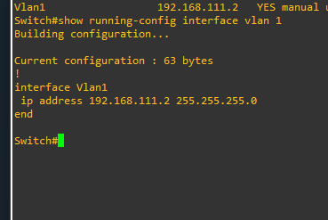
  * *Qué se hizo:* Se verificaron los comandos de ejecución rápida (`running-config`) en las interfaces troncales y de acceso para asegurar que el encapsulamiento 802.1Q operara correctamente.

* **Estado de la Interfaz F0 (FastEthernet):**
  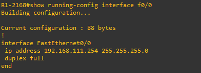
  * *Qué se hizo:* Se comprobó el estado operativo y administrativo de la interfaz FastEthernet principal, validando su velocidad, modo dúplex y estado de enlace (`up/up`).

* **Verificación de Interfaces del Switch (`show ip int brief`):**
  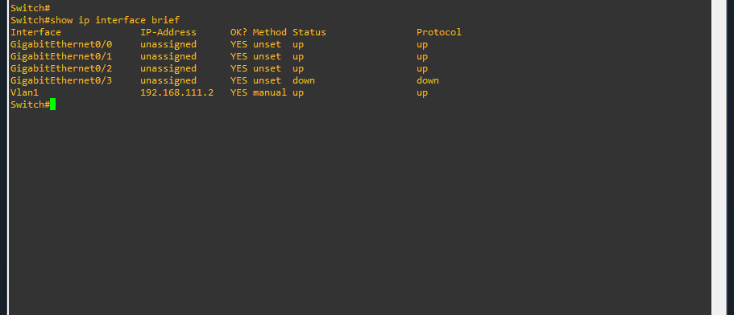
  * *Qué se hizo:* Se ejecutó el comando de resumen de interfaces en el switch para corroborar qué puertos se encuentran activos y qué VLAN nativa o de acceso tienen asignada.

* **Verificación de Interfaces del Router (`SW INT BRIEF R1`):**
  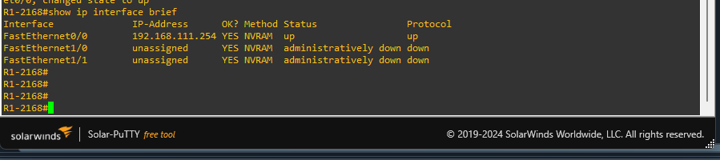
  * *Qué se hizo:* Se validó el estado de las subinterfaces y enlaces físicos en el enrutador principal (`R1`), asegurando la correcta comunicación inter-VLAN (Router-on-a-Stick).

---

## 3. Configuración del Servicio DHCP

* **Configuración DHCP en Router (Parte 1):**
  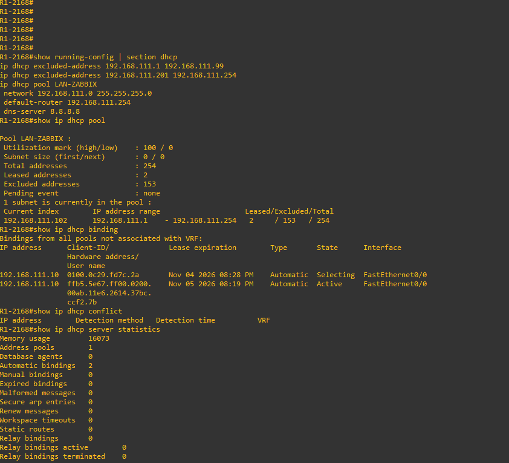
  * *Qué se hizo:* Se configuró el pool de direcciones IP dinámicas en el enrutador, especificando la red base, la máscara de subred y la puerta de enlace predeterminada (`default-router`).

* **Configuración DHCP en Router (Parte 2):**
  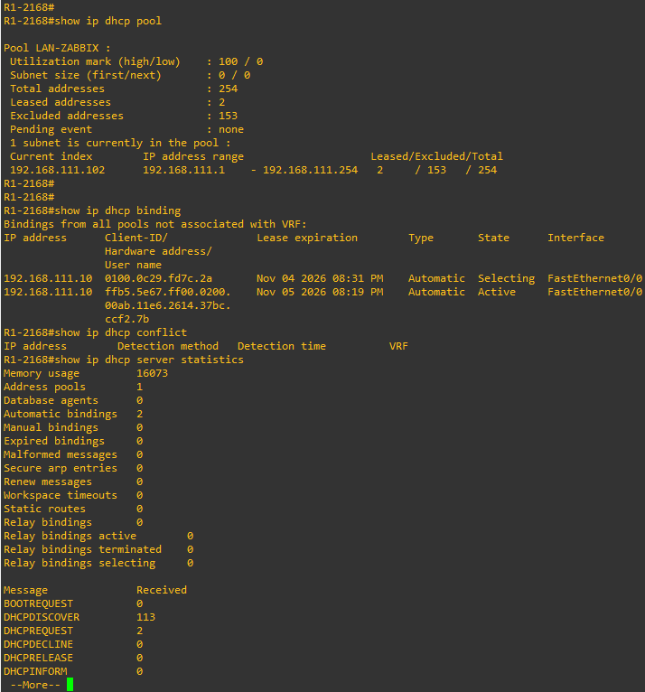
  * *Qué se hizo:* Se definieron las exclusiones de direcciones IP estáticas (rangos reservados para servidores y pasarelas) y se ajustaron los parámetros de tiempo de concesión (*lease time*) y servidores DNS.

---

## 4. Configuración del Protocolo SNMP

* **Configuración de Comunidad SNMP en Switch:**
  
  * *Qué se hizo:* Se estableció la cadena de comunidad SNMP (tanto para lectura como para escritura según fuera necesario) para autenticar las peticiones del servidor de monitoreo hacia el switch.

* **Configuración de Permisos de Solo Lectura (Switch):**
  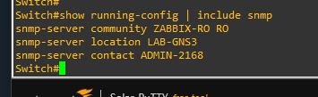
  * *Qué se hizo:* Se restringieron los permisos del protocolo SNMP a modo de solo lectura (`ro-community`) en el switch para salvaguardar la seguridad de la infraestructura ante modificaciones no autorizadas.

* **Configuración General de Solo Lectura:**
  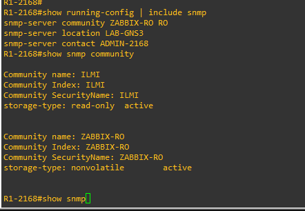
  * *Qué se hizo:* Se aplicaron políticas globales de seguridad SNMP en los dispositivos de borde para limitar las IPs de origen que pueden consultar las métricas del equipo.

* **Comandos de Verificación SNMP:**
  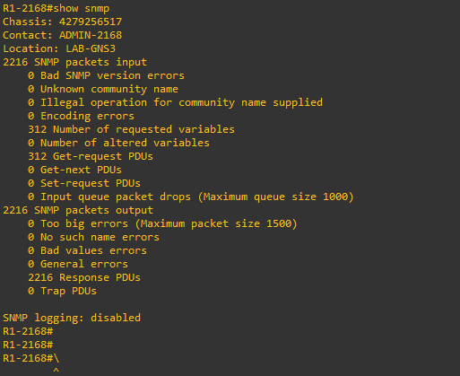
  * *Qué se hizo:* Se utilizó el comando de diagnóstico para verificar que el motor SNMP estuviera activo, mostrando las estadísticas de paquetes procesados y las comunidades habilitadas.

* **Verificación de Parámetros SNMP (CM):**
  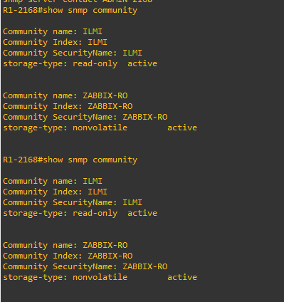
  * *Qué se hizo:* Se comprobaron los contadores de gestión y las vistas de objetos (MIBs) accesibles mediante la consola de comandos.

---

## 5. Servidor Zabbix y Monitoreo

* **Verificación de Red y Enrutamiento en Servidor Zabbix:**
  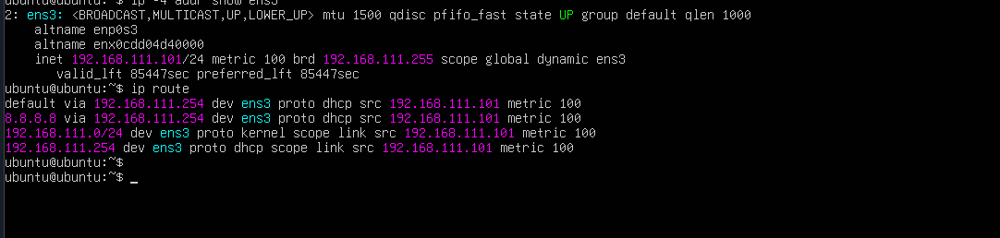
  * *Qué se hizo:* Se validó la configuración de red en el sistema operativo del servidor Zabbix mediante comandos de rutas IP e inspección de interfaces de red (`wns3`), garantizando conectividad hacia toda la topología.

* **Listado y Estado de Hosts Registrados en Zabbix:**
  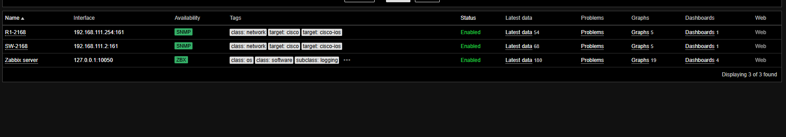
  * *Qué se hizo:* Se dio de alta cada dispositivo de red (routers y switches) en la interfaz web de Zabbix, asociándoles las plantillas (*templates*) predeterminadas de monitoreo por ICMP y SNMP.

* **Panel de Control de Zabbix (Matrícula 2168):**
  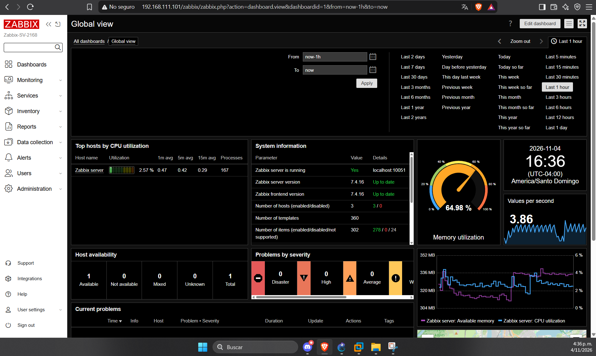
  * *Qué se hizo:* Se personalizó el dashboard principal del sistema de monitoreo para reflejar el estado general de los elementos correspondientes a la matrícula de evaluación (2168).

* **Métricas y Rendimiento del Router (R1):**
  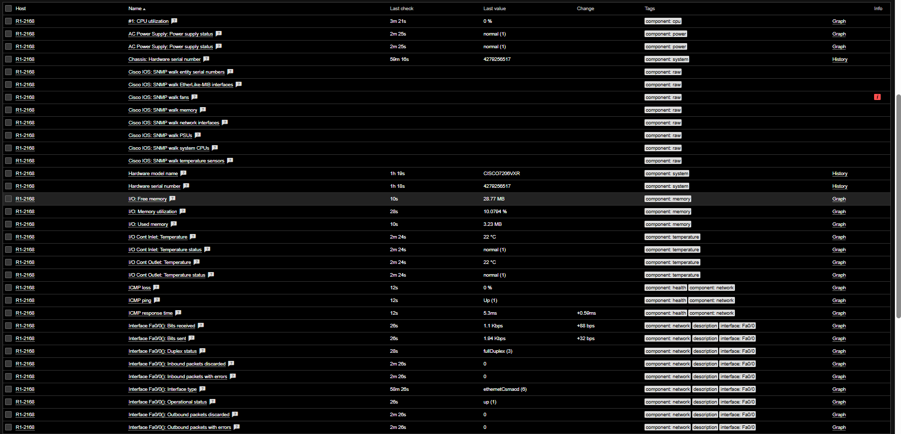
  * *Qué se hizo:* Se analizaron las gráficas en tiempo real de uso de CPU, consumo de memoria y tráfico por interfaces correspondientes al enrutador `R1`.

* **Métricas SNMP del Switch:**
  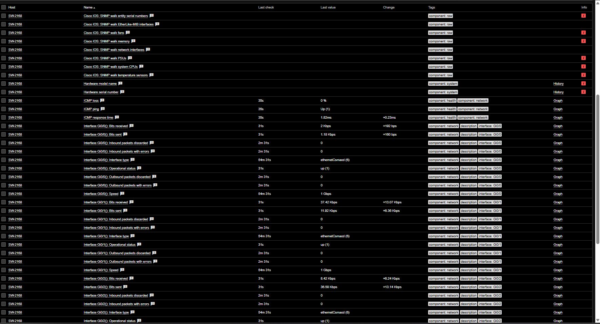
  * *Qué se hizo:* Se comprobaron las gráficas de estado de puertos, errores de trama y tráfico pasante recolectadas exitosamente por Zabbix a través de las consultas SNMP realizadas al switch.
