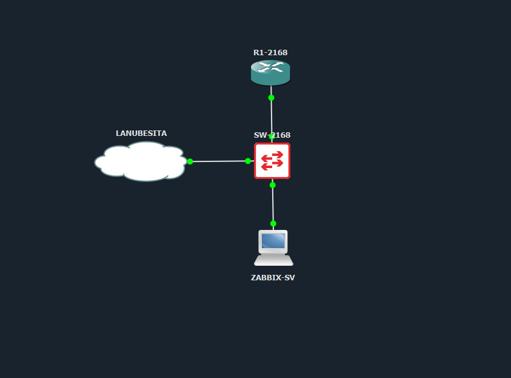
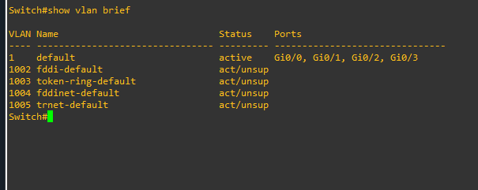

# Asignación 3: Configuración de Red, VLANs, DHCP, SNMP y Monitoreo con Zabbix

Este repositorio documenta el desarrollo de la **Asignación 3**, enfocada en el diseño e implementación de una infraestructura de red, segmentación mediante VLANs, configuración del servicio DHCP, administración mediante SNMP y monitoreo centralizado utilizando Zabbix.

El proyecto incluye las configuraciones realizadas, evidencias de implementación, diagrama de infraestructura y un mapa interactivo para facilitar la visualización de la topología.

---

## 📹 Video Explicativo de la Práctica

Puedes visualizar la explicación del desarrollo y funcionamiento de la práctica en el siguiente enlace:

- **[Ver video explicativo en YouTube](https://youtu.be/lfPVDD8CJ9c)**

---

## 1. Topología de Red e Infraestructura

### 🗺️ Topología de Red Interactiva

```mermaid
graph TD
    %% Estilos de Nodos
    classDef router fill:#2b3a4a,stroke:#4a90e2,stroke-width:2px,color:#fff;
    classDef switch fill:#1b4332,stroke:#2ec4b6,stroke-width:2px,color:#fff;
    classDef server fill:#4a154b,stroke:#a855f7,stroke-width:2px,color:#fff;
    classDef cloud fill:#334155,stroke:#94a3b8,stroke-width:2px,color:#fff;

    %% Dispositivos de la Red
    R1["🌐 R1-2168<br/>Fa0/0 • 192.168.111.254/24<br/>DHCP Server / SNMP RO"]:::router
    SW["🔀 SW-2168<br/>VLAN 1 • 192.168.111.2/24<br/>SNMP RO"]:::switch
    ZABBIX["🖥️ ZABBIX-SV<br/>DHCP (192.168.111.x)<br/>Zabbix Server / SNMP Manager"]:::server
    CLOUD["☁️ LANUBESITA<br/>Conexión LAN / Externa"]:::cloud

    %% Enlaces e Interconexiones
    R1 <== "Fa0/0 ↔ Gi0/0" ==> SW
    SW <== "Gi0/1 ↔ eth0 (DHCP)" ==> ZABBIX
    SW <== "Gi0/2 ↔ eth0" ==> CLOUD

### 🖧 Diagrama General de la Infraestructura

El siguiente diagrama representa visualmente la estructura de la red, incluyendo los dispositivos de interconexión, switches y servidores involucrados en la práctica.


### Descripción

Se diseñó e implementó una topología de red para representar la comunicación entre los diferentes dispositivos de infraestructura. Se estableció un esquema de direccionamiento IP y una distribución lógica de la red para permitir la segmentación del tráfico y la comunicación entre las distintas VLANs.

### Tabla de Direccionamiento IP

| Dispositivo | Interfaz | Dirección IP | Máscara de Red | Default Gateway | Servicio / Rol |
| :--- | :--- | :--- | :--- | :--- | :--- |
| **R1-2168** | FastEthernet0/0 | `192.168.111.254` | `255.255.255.0` (`/24`) | N/A | Gateway de la Red (Default Router DHCP) |
| **SW-2168** (Switch) | Vlan1 | `192.168.111.2` | `255.255.255.0` (`/24`) | `192.168.111.254` | Interfaz de Gestión (SVI)[cite: 4] |
| **Pool DHCP** (`LAN-ZABBIX`) | Subred | `192.168.111.0` | `255.255.255.0` (`/24`) | `192.168.111.254` | Rango de red asignable por DHCP (DNS: `8.8.8.8`) |
| **ZABBIX-SV** | Ethernet | `192.168.111.100` - `200` | `255.255.255.0` (`/24`) | `192.168.111.254` | Servidor Zabbix (Asignado por DHCP)* |
---

## 2. Configuración de VLANs y Puertos

### Creación y configuración de VLANs



**Qué se realizó:** Se crearon las VLANs necesarias para segmentar la red y separar el tráfico de acuerdo con la distribución establecida en la práctica.

### Configuración de interfaces VLAN


**Qué se realizó:** Se verificaron las configuraciones de las interfaces, incluyendo los puertos de acceso y los enlaces troncales, para garantizar la correcta comunicación entre los dispositivos.

### Estado de la interfaz FastEthernet


**Qué se realizó:** Se comprobó el estado operativo de la interfaz FastEthernet, verificando su disponibilidad y estado de conexión.

### Verificación de interfaces del switch


**Qué se realizó:** Se utilizó el comando `show ip interface brief` para comprobar el estado de las interfaces del switch y verificar su funcionamiento.

### Verificación de interfaces del router R1


**Qué se realizó:** Se verificaron las interfaces y subinterfaces del router R1 para comprobar el funcionamiento de los enlaces y el enrutamiento entre VLANs.

---

## 3. Configuración del Servicio DHCP

### Configuración DHCP en R1


**Qué se realizó:** Se configuraron los pools DHCP para permitir la asignación automática de direcciones IP a los dispositivos de la red, estableciendo los parámetros correspondientes a cada segmento.

### Configuración adicional DHCP


**Qué se realizó:** Se configuraron las exclusiones de direcciones IP y los parámetros necesarios para administrar correctamente la asignación de direcciones dinámicas, incluyendo las puertas de enlace y los servidores DNS.

---

## 4. Configuración del Protocolo SNMP

### Configuración de comunidad SNMP en el switch

**Qué se realizó:** Se configuró la comunidad SNMP para permitir la comunicación entre los dispositivos de red y el servidor encargado del monitoreo.

### Configuración SNMP de solo lectura


**Qué se realizó:** Se establecieron permisos de solo lectura para consultar información del dispositivo sin permitir modificaciones mediante SNMP.

### Configuración general SNMP


**Qué se realizó:** Se aplicaron configuraciones de acceso SNMP para permitir la consulta de información de administración y supervisión de los dispositivos.

### Comandos de verificación SNMP


**Qué se realizó:** Se ejecutaron comandos de verificación para comprobar el funcionamiento del protocolo SNMP y consultar sus estadísticas.

### Verificación de parámetros SNMP


**Qué se realizó:** Se verificaron los parámetros de administración y la información disponible mediante el protocolo SNMP.

---

## 5. Servidor Zabbix y Monitoreo de Red

### Configuración de red del servidor Zabbix


**Qué se realizó:** Se verificó la configuración de red del servidor Zabbix mediante comandos de direccionamiento IP y tablas de enrutamiento para comprobar su conectividad.

### Hosts registrados en Zabbix


**Qué se realizó:** Se registraron los dispositivos de infraestructura en la plataforma Zabbix, configurando los parámetros necesarios para su supervisión mediante ICMP y SNMP.

### Dashboard de Zabbix


**Qué se realizó:** Se organizó el panel principal de Zabbix para visualizar el estado general de los dispositivos registrados y facilitar el seguimiento de la infraestructura.

### Métricas y rendimiento del router R1


**Qué se realizó:** Se visualizaron las métricas de rendimiento del router R1, incluyendo información sobre el tráfico de red y los recursos del dispositivo.

### Métricas SNMP del switch


**Qué se realizó:** Se verificaron las métricas recopiladas mediante SNMP para supervisar el comportamiento de las interfaces y el tráfico del switch.

---

## 6. Herramientas y Tecnologías Utilizadas

- **Routers y switches:** Configuración y administración de dispositivos de red.
- **VLAN:** Segmentación lógica de la infraestructura.
- **DHCP:** Asignación dinámica de direcciones IP.
- **SNMP:** Protocolo de administración y supervisión de dispositivos.
- **Zabbix:** Plataforma centralizada de monitoreo.
- **Linux:** Administración y configuración del servidor Zabbix.
- **GitHub:** Documentación y almacenamiento del proyecto.

---

## 7. Objetivos Alcanzados

- Diseño e implementación de una topología de red.
- Segmentación de la infraestructura mediante VLANs.
- Configuración del servicio DHCP.
- Implementación del protocolo SNMP.
- Integración de dispositivos de red con Zabbix.
- Supervisión del estado y rendimiento de routers y switches.
- Documentación de las configuraciones y evidencias del proyecto.

---

## 8. Conclusión

Con esta práctica pude trabajar con diferentes tecnologías de administración y monitoreo de redes, comprendiendo cómo se relacionan las VLANs, DHCP y SNMP dentro de una infraestructura. También pude implementar Zabbix para supervisar los dispositivos y visualizar sus métricas, lo que me permitió comprender mejor la importancia de mantener una red organizada, funcional y monitoreada.

---

**Proyecto académico – Asignación 3**  
**Repositorio:** [SR--A3](https://github.com/sebas533/SR--A3)  
**Autor:** Sebastian Roble
